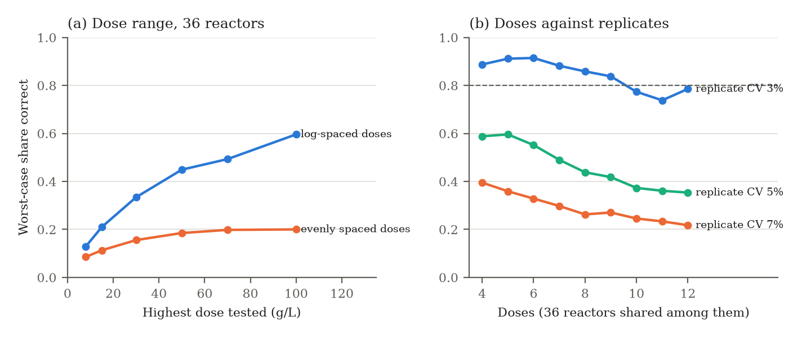

# Designing a biochar dose experiment that can find an optimum

**Status: simulation only.** It tells you which experiment to run. It says nothing
about how biochar behaves.
Protocol: [`data/validation/dose_design_v1.json`](../data/validation/dose_design_v1.json),
committed in `4bd2eea` before the search was run.
Outputs: [`results/dose-design/`](../results/dose-design/).

## The problem

Many biochar studies report an "optimal dose" from three to five doses with triplicate
bottles, and the tested ranges differ widely. In this project, a curved dose response
lost to a straight line on the five doses of Valentin and Białowiec (2024), which end at
8 g/L. The question is whether that result could have come out otherwise, and what
design would have answered it.

The question here: **with a fixed number of reactors, how should they be split between
doses and replicates, and how high should the doses go, so that a held-out test picks
the right dose-response form even though the location of any optimum is unknown?**

## Method

- **Truths (6).** No dose effect; a monotone effect; and an optimum at 5, 10, 20 or 40 g/L.
  The size of the effect at its peak is 8% or 15% of methane potential.
- **Replicate variability.** Log-scale standard deviation of 0.03, 0.05 or 0.07 between
  replicate reactors. For reference, the eligible Kozłowski et al. (2025) reactors give
  0.006 to 0.037 per treatment, from only 2 or 3 reactors each.
- **Designs (396).** Budgets of 18, 24, 36 and 48 reactors; 4 to 12 doses including zero;
  as many replicates as fit; highest dose 8 to 100 g/L; doses evenly spaced either in
  ln(1 + dose) or in dose.
- **Decision.** The project's frozen Stage A rule, applied to methane potential: hold out
  every dose in turn with all its replicates, and keep the simplest form unless a more
  complex one lowers the held-out error by more than 10%.
- **Objective.** The worst share of correct decisions across the six truths (maximin).
  2,000 simulations per scenario, 14,256 scenarios.

This is a fast surrogate of the full trajectory simulation in
[`results/stage-a-power/`](../results/stage-a-power/). It ignores curve-fitting error and
the rate parameter. On the four designs simulated both ways it agrees in direction but
is more pessimistic about detecting an optimum (for example 0.71 against 0.96 for the
dense eight-dose grid at 0.03). The full simulation has only 24 runs per case
([`agreement.csv`](../results/dose-design/agreement.csv)).

## Results



**1. The highest dose matters most.** With 36 reactors, a 15% effect and 5% replicate
variability, the best worst-case share correct rises from 0.13 with doses up to 8 g/L to
0.60 with doses up to 100 g/L. Every best design used the highest dose searched (100 g/L,
70 g/L in two cases). The true best highest dose may lie above the searched range.

**2. Space doses evenly on a log scale.** Doses evenly spaced in ln(1 + dose) beat evenly
spaced doses at every range: 0.60 against 0.20 at 100 g/L in the same setting.

**3. Fewer doses, more replicates.** At a fixed budget, 4 to 6 doses with many replicates
beat 10 to 12 doses in triplicate. With 36 reactors at 5% variability: 0.59 for 4 doses × 9
against 0.35 for 12 × 3.

**4. The hardest case is a far optimum.** In every setting the worst truth was the optimum
at 40 g/L, where the curve is still rising across most of a moderate dose range.

**5. Most realistic budgets cannot answer the question reliably.**

| Peak effect | Replicate variability | 18 | 24 | 36 | 48 reactors |
| --- | --- | ---: | ---: | ---: | ---: |
| 15% | 0.03 | 0.75 | **0.83** | **0.91** | **0.95** |
| 15% | 0.05 | 0.42 | 0.48 | 0.60 | 0.68 |
| 15% | 0.07 | 0.27 | 0.31 | 0.40 | 0.47 |
| 8% | 0.03 | 0.37 | 0.47 | 0.52 | 0.63 |
| 8% | 0.05 | 0.21 | 0.24 | 0.28 | 0.31 |
| 8% | 0.07 | 0.13 | 0.15 | 0.17 | 0.16 |

Values are the worst-case share correct of the best design for each budget. Only a 15% peak
effect with about 3% replicate variability reaches 0.80, from 24 reactors (6 doses × 4,
log-spaced to 100 g/L). For an 8% effect, close to the 4.5% to 11.9% potential gains measured
in the Kozłowski data, no design up to 48 reactors reaches 0.80.

**6. The earlier negative result was uninformative about an optimum.** A 24-reactor design
ending at 8 g/L reaches at best 0.29 for an optimum at 10 g/L and 0.15 for one at 40 g/L
(15% effect, 5% variability). The log-linear win on Valentin and Białowiec's table cannot
rule out an optimum above 8 g/L.

## Recommended design

For one biochar, one substrate and one temperature:

- 6 doses evenly spaced in ln(1 + dose) from 0 to 100 g/L: 0, 1.5, 5.3, 14.9, 39.1 and 100 g/L;
- 4 replicate reactors per dose (24 reactors), plus inoculum blanks and a positive control;
- reduce replicate variability below about 3% (same inoculum batch, mixing and gas
  measurement); this matters as much as the number of reactors;
- state before the run that a non-detection means "not resolved at this power", not
  "no optimum".

## Limitations

- Simulation with assumed truths, effect sizes and normal errors. It uses methane
  potential only; the trajectory-level rule also uses rate information.
- The searched range ended at 100 g/L and the best designs sat at that edge. Very high
  doses may change the system in ways the dose-response forms do not represent (mass
  transfer, pH, adsorption of intermediates).
- Batch-to-batch variation is not modelled; all arms must run in the same batch.

## Reproduce

```bash
python scripts/run_dose_design.py         # about 2 minutes
python scripts/make_research_figures.py
pytest -q tests/test_dose_design.py
```
