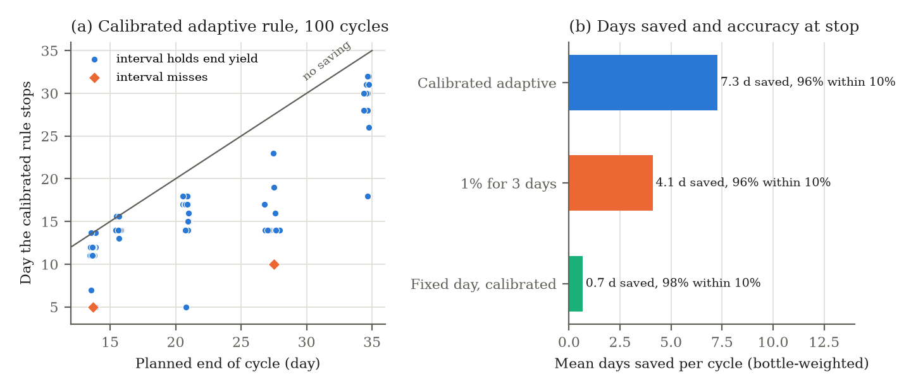

# Calibrated early stopping of batch methane tests

**Status: retrospective, within one study. Not prospectively validated.**
Protocol: [`data/validation/early_stopping_v1.json`](../data/validation/early_stopping_v1.json),
committed in `25fd243` before any result was computed.
Outputs: [`results/early-stopping/`](../results/early-stopping/).

## The problem

A biochemical methane potential (BMP) test usually runs until production levels off.
The consensus rule ends a test when the daily methane production on each of three
consecutive days is below 1% of the accumulated volume (Holliger et al., 2016, 2021).
That rule says when the curve is flat. It does not say how wrong the reported value
can be.

Several studies predict the final BMP from the first days of a test, using kinetic
fits or regression on earlier tests (Strömberg et al., 2015; Catenacci et al., 2022;
Calabrò et al., 2023). They report average prediction errors, such as relative RMSE
below 10% after about six days. An average error does not tell an operator whether
**this** bottle can be stopped today.

This analysis asks a narrower operational question: can a stopping decision carry an
error bound whose coverage has been checked on bottles that were not used to set it?
We did not find a published BMP study that reports distribution-free intervals of this
kind with the bottle as the unit of exchangeability. That statement reflects the
searches recorded below. It is not proof that no such study exists.

## Method

| Step | Choice |
| --- | --- |
| Data | The 100 long cycles from 27 bottles in two laboratories (Sanglier et al., 2022), as in the [forecast benchmark](FORECAST_BENCHMARK.md) |
| Target | Cumulative yield at the planned end of the cycle (13.7 to 34.6 days) |
| Cutoffs | Every whole day from day 5 to one day before the end (1,523 bottle, cycle and day combinations) |
| Point forecast | Recent rate: slope of the last three readings, negative slope set to zero, extended to the planned end |
| Uncertainty | Split conformal prediction with each bottle weighted equally (CDF pooling; Dunn, Wasserman and Ramdas, 2023) |
| Score | Absolute log ratio of forecast to true value, divided by the forecast's own projected remaining gain (minimum 1%) |
| Rule | Stop the first day the 90% interval is within a factor of 1.10 of the forecast |
| Validation | Leave one bottle out (27 folds); leave one laboratory out (2 folds) |

Because all scores are log ratios, the unverified unit of the Sanglier yields cancels.

**What the rule amounts to.** The calibrated quantile was 0.683 to 0.696 across folds.
The rule therefore stops when the projected remaining gain to the planned end is below
about 14.7% of the yield already measured. The forecast at that moment is then within
about 10% of the end value, at a stated 90% level.

## Results

Leave-one-bottle-out, all 100 cycles. Coverage and accuracy are bottle-weighted. A rule
that does not fire runs to the end, saving no time and making no error.

| Rule | Cycles stopped early | Coverage at stop | Within 10% at stop | Median stop day | Mean days saved per cycle |
| --- | ---: | ---: | ---: | ---: | ---: |
| Calibrated adaptive | 91 of 100 | 0.957 | 0.963 | 14.0 (IQR 13.7 to 17.0) | 7.3 |
| 1% for 3 days | 17 of 100 | not an interval | 0.957 | 17.0 | 4.1 |
| Calibrated fixed day | 9.5% of bottles | 0.981 | 0.981 | day 25 to 28 by fold | 0.7 |

The median planned end was day 20.8. The adaptive rule missed in 2 of the 91 cycles it
stopped: bottle II.4 at day 10 (true value 19% from the forecast) and failing control
IV.2 at day 5 (5% off, outside a very narrow interval). Among the 17 cycles where the 1%
rule fired, 15 were within 10% of the end value.



A single stopping day for every bottle cannot meet the 10% bound until day 25 to 28,
because cycles that are still producing dominate the error. A state-dependent rule can
stop flat bottles early and keep active bottles running. That is the main finding.

### Pre-registered criteria

| Criterion | Result | Value |
| --- | --- | --- |
| C1: coverage over all combinations in [0.85, 0.95] | **Fail** (too conservative) | 0.951 fixed, 0.959 normalised |
| C2: coverage at the adaptive stopping day at least 0.85 | Pass | 0.957 |
| C3: adaptive median stop earlier than fixed-day rule, and stops early in more than half of cycles | Pass | day 14 against 28; 91% |
| C4: leave-one-laboratory-out coverage at stop at least 0.85 both ways | Pass as defined, but see below | 0.917 and 1.000 |

**C1 was mis-specified.** With 26 calibration bottles the conformal method targets a
level of 25/26 = 0.962, above the criterion's upper bound of 0.95. The intervals are
slightly conservative, as the method intends. Under the pre-registration this is
recorded as a fail, and the criterion was not changed after the run.

**C4 passes only formally.** Calibrated on laboratory LBE and tested on BRL (12 cycles),
the rule stopped all cycles, at a median of day 23 against a planned 27.3, with coverage
0.917. On those BRL cycles the 1% rule did better: it saved 8.3 days on average at the
same 0.917 accuracy. Calibrated on BRL and tested on LBE (88 cycles), the interval was so
wide that the rule stopped only 8% of bottles early. Coverage of 1.000 there is reached
by not stopping. The rule does not yet transfer usefully between laboratories.

Without the two failing control bottles (25 bottles, 88 cycles) the adaptive rule gave
coverage 0.960 and saved 7.4 days on average.

## Limitations

- One study, two laboratories, 27 bottles, one substrate family. Repeated cycles of a
  bottle share digestate and are not independent; the bottle is the unit throughout.
- Retrospective. The point forecaster was chosen after it performed best on these same
  cycles at 12.5 days (disclosed in the protocol). The calibration and stopping results
  are new; the forecaster's accuracy is not.
- The target is yield at the planned end of the repeated-batch cycle, not the ultimate
  methane potential of a fresh-inoculum BMP test. Sanglier yields are gross, not
  blank-corrected, so the 1% rule was applied in an adapted form.
- Conformal coverage is guaranteed for a fixed cutoff. Coverage **at a data-dependent
  stopping time** is not covered by that guarantee; it is checked here empirically only.
- Coverage did not transfer between laboratories in one direction. Each laboratory
  would need its own calibration bottles.

## What would test it properly

A prospective run in one laboratory: calibrate on at least 20 earlier bottles, freeze the
quantile, then apply the rule to a new batch run to completion, and report coverage at
the stopping day. This would be a new protocol alongside the frozen
[future-batch forecast](FUTURE_BATCH_FORECAST.md), which tests point accuracy only.

## Reproduce

```bash
python scripts/run_early_stopping.py      # about 3 s
python scripts/make_research_figures.py
pytest -q tests/test_early_stopping.py
```

## Literature checked (17 November 2026)

Searches covered early BMP prediction, BMP uncertainty and stopping criteria, and
conformal prediction in anaerobic digestion. Closest work found: Strömberg et al. (2015),
Catenacci et al. (2022), Calabrò et al. (2023) and a patent on early estimation of
anaerobic degradability (US 12278000 B2). None reported bottle-level calibrated coverage.

- Holliger, C. et al. (2016). Towards a standardization of biomethane potential tests.
  *Water Science and Technology* 74(11), 2515–2522. https://doi.org/10.2166/wst.2016.336
- Strömberg, S., Nistor, M., Liu, J. (2015). Early prediction of biochemical methane potential
  through statistical and kinetic modelling of initial gas production. *Bioresource Technology*
  176, 233–241. https://doi.org/10.1016/j.biortech.2014.11.033
- Catenacci, A., Santus, A., Malpei, F., Ferretti, G. (2022). Early prediction of BMP tests:
  a step response method for estimating first-order model parameters. *Renewable Energy* 188,
  184–194.
- Calabrò, P. S. et al. (2023). Exploring the possibility to shorten the duration and reduce
  the number of replicates in biomethane potential tests (BMP). *Waste and Biomass
  Valorization* 14, 2481–2493. https://doi.org/10.1007/s12649-022-01893-9
- Dunn, R., Wasserman, L., Ramdas, A. (2023). Distribution-free prediction sets for two-layer
  hierarchical models. *Journal of the American Statistical Association* 118(544), 2491–2502.
  https://doi.org/10.1080/01621459.2022.2060112
- Sanglier, M. et al. (2022). Dataset. https://doi.org/10.57745/BUJORT
