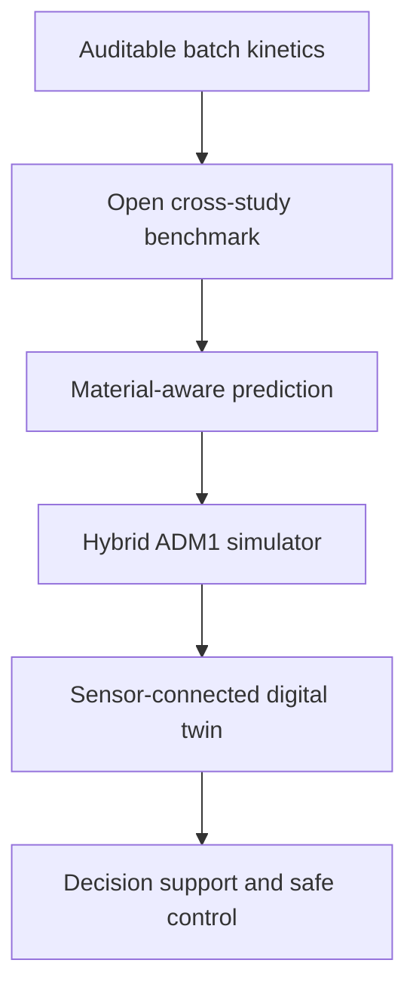

# Roadmap

This page describes where the project could go and the evidence each stage
requires. It describes direction, not current capability. For what the repository
supports today, see [`PROJECT_STATUS.md`](PROJECT_STATUS.md).

## Staged development

The long-term opportunity is a research-to-operations platform for biochar-assisted
anaerobic digestion. That future should be earned in stages, with every new capability
unlocked by stronger data rather than by a larger claim.

| Stage | What the project becomes | Minimum evidence required | Claim unlocked |
| --- | --- | --- | --- |
| 0 — current | Auditable batch-kinetics benchmark and contribution workflow | Traceable reactor trajectories, explicit blanks/controls and leakage-safe splits | Reproducible within-dataset kinetic comparison |
| 1 — open benchmark | FAIR, versioned multi-study data resource with common units, material metadata and benchmark tasks | Redistribution rights, DOI/source hashes, transformation logs and study-held-out evaluation | Reproducible comparison across published studies |
| 2 — material-aware predictor | Model linking dose and operating conditions with feedstock, pyrolysis temperature, BET area, conductivity, pH and surface chemistry | Sufficiently diverse studies; collinearity checks; calibrated uncertainty; external-study validation | Conditional prediction for unseen study/material combinations within a declared domain |
| 3 — hybrid process simulator | ADM1-based mass balances augmented by validated biochar effects or learned parameter mappings | Continuous-reactor measurements of gas, VFA, ammonia, pH and feed composition; mass-balance closure | Dynamic scenario testing, not merely cumulative-curve fitting |
| 4 — experiment and decision support | Uncertainty-aware comparison of material, dose and operating scenarios; active-learning suggestions for the next experiment; optional cost, energy and carbon objectives | Prospective tests showing recommendations outperform fixed or expert-only designs; validated economic and life-cycle inputs for non-process objectives | Multi-objective decision support with a stated applicability domain |
| 5 — operational digital twin | A live reactor counterpart combining sensor streams, delayed laboratory results, state estimation and online calibration | Timestamped plant data, fault handling, drift detection and prospective site validation | Monitored state estimation and forecasting for a specific plant |
| 6 — safe optimisation | Human-supervised model-predictive control for feed, loading or other permitted actions | Safety constraints, fail-safe modes, operator approval and controlled field trials | Operational optimisation at validated sites |

An API, dashboard and collaborative data portal can support every stage, but they are
delivery layers rather than substitutes for scientific validation.

## Problem → evidence → capability

1. **Now — pass Stage A dose validation.** Acquire independent reactor-level trajectories
   at one digestion temperature, including a zero-dose control, at least three amended
   doses of the same material, intact replicates, blanks and provenance. Freeze QC and model
   comparisons before viewing held-out outcomes.
2. **Next — prove transfer across studies and materials.** Build a licensed, FAIR dataset;
   standardise units and metadata; establish simple baselines; and evaluate only with whole
   studies and whole material families held out.
3. **Then — add mechanism-compatible dynamics.** Introduce ADM1 or another mass-balanced
   process model, measure the states needed to identify biochar effects, and compare a
   mechanistic baseline with hybrid mechanistic–machine-learning alternatives.
4. **Later — connect a real reactor.** Ingest timestamped sensors and delayed laboratory
   measurements, estimate hidden states, quantify drift and uncertainty, and validate
   forecasts prospectively before any control recommendation is exposed.
5. **Finally — test decisions, not just predictions.** Evaluate experiment selection,
   operational recommendations and constrained control against predefined safety and
   performance criteria, with operators retaining authority.

## Research basis for this direction

- [ADM1](https://doi.org/10.2166/wst.2002.0292) provides the established biochemical and
  physicochemical modelling foundation for a future mass-balanced simulator.
- A [hybrid ADM1–machine-learning study](https://doi.org/10.1016/j.biombioe.2024.107176)
  demonstrates a credible route for predicting sensitive kinetic parameters from feedstock
  and operating information rather than replacing process structure with a black box.
- ADM1-based [state estimation on a full-scale biogas plant](https://doi.org/10.2166/wst.2012.174)
  and anaerobic-digestion [online soft sensors](https://doi.org/10.3390/pr8010067) show the
  additional measurement and estimation layers required before “digital twin” is an
  operational claim.
- Anaerobic-digestion [model-predictive-control research](https://doi.org/10.2166/wst.2025.151)
  motivates the final control stage, but only after plant-specific forecasting and safety
  validation.
- The [FAIR Guiding Principles](https://doi.org/10.1038/sdata.2016.18) motivate making the
  data, metadata, algorithms and workflows findable, accessible, interoperable and reusable.
- Evidence that anaerobic-digestion experiments need stronger standardisation
  ([Lavergne et al., 2018](https://doi.org/10.1016/j.jenvman.2018.05.030)) supports treating
  data quality and shared reporting as the first research infrastructure, not an afterthought.
